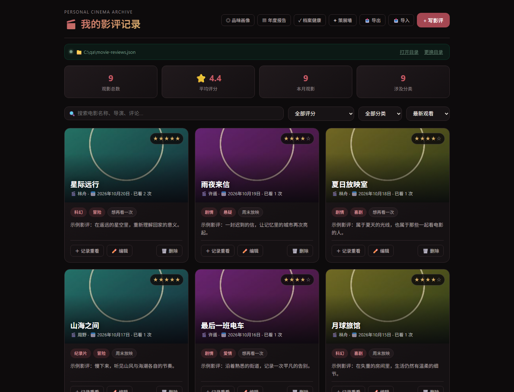
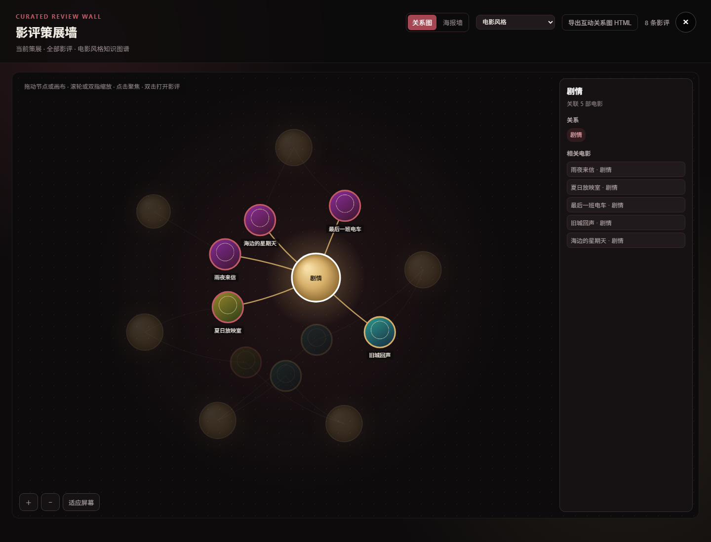

# 我的影评记录 · movie_evaluation

**把观影记录、重看感受和电影之间的联系，保存成自己的长期档案。**

A privacy-focused film journal with a local Windows app and a self-hosted web version.

[](https://github.com/z2995299523-zrz/movie_evaluation/actions/workflows/validate.yml)
[](LICENSE)

[快速开始](#快速开始) · [功能](#功能) · [网页版](#网页版开发与部署) · [测试](#测试与持续集成) · [参与贡献](CONTRIBUTING.md) · [English overview](#english-overview)

## 项目简介

我的影评记录是一个由个人持续维护的电影档案工具。除了片名、评分和影评，它也记录每次重看的感受、观看地点、同行人和人生阶段，让观影历史保留自己的语境。

项目提供两种使用方式，复用页面和档案字段：

| | Windows 桌面版 | 自部署网页版 |
| --- | --- | --- |
| 使用方式 | 从源码运行，或自行构建单文件 EXE | 部署 Python Web 服务，通过浏览器登录 |
| 数据保存 | 用户选择目录中的 JSON、原始剧照和历史备份 | 部署者管理的 SQLite 数据库与媒体目录 |
| 账户 | 本机个人使用，无须网站账户 | 多用户登录、管理员管理、按用户隔离档案与媒体 |
| 网络 | 不启动本地 HTTP 服务，不监听网络端口；档案不自动上传 | 应用监听回环地址，经 HTTPS 反向代理提供访问 |
| 迁移 | 导入旧版 JSON，导出包含剧照的 ZIP | 支持档案导入导出和服务器备份；不自动同步桌面日常修改 |

项目适合希望长期保存个人观影历史的影迷，也为个人档案、数据可迁移性和小型应用自部署提供可阅读的实现。项目仍处于早期；尚未发布经过核实的月下载量或活跃用户统计。可通过 [提交记录](https://github.com/z2995299523-zrz/movie_evaluation/commits/main/)与 [CI](https://github.com/z2995299523-zrz/movie_evaluation/actions/workflows/validate.yml)了解实际维护情况。

## 界面预览

以下为当前应用界面的实际截图，使用内存中的虚构示例档案与程序生成的抽象配图，不包含维护者的个人档案或电影原始剧照。示例中的评分、评论和观看时间仅用于演示。

### 观影档案



### 电影关系图谱



## 功能

- **影评与重看**：录入、编辑、删除影评；重看作为独立事件记录时间、独立评分与当次感受，可修改、删除，并用曲线展示评分变化。
- **个人观影背景**：记录观看地点、同行人、心情、人生阶段、影响、难忘场景、台词、推荐对象和再次重看意愿。
- **查找与浏览**：按片名、导演、评论或标签搜索，按评分与标签筛选，按日期、评分或名称排序。详情弹窗支持上一个 / 下一个，以及键盘左右方向键，遵循当前筛选和排序。
- **原始剧照**：每条影评可附一张 JPG、PNG 或 WebP，支持选择文件和桌面拖入；全屏查看可缩放、拖动。保留原始图片字节与画质。
- **策展墙与关系图谱**：高密度海报墙，以及力导向 Canvas 图谱。关系节点随关联电影数量变大，电影显示为圆形剧照节点；支持拖动、缩放和邻居聚焦，可切换电影风格、导演、观影年份、评分、重看状态与补充标签。
- **回顾与统计**：观影总数、平均评分、本月观影数与分类数；“历史上的今天”回顾往年同日记录，无周年记录时推荐一年以上未看的高分电影。“品味画像”统计分类、导演、评分、重看率、年度观影与代表电影，并说明计算依据。
- **年度报告与导出**：按年份汇总初看、重看、评分、分类、导演与月度分布，可导出独立 HTML；当前筛选下的海报墙可导出 PNG，知识图谱可导出可点击的离线互动 HTML。
- **档案整理**：检查缺失字段、日期异常、疑似重复和分类别名，支持确认后批量合并分类。
- **数据保存与恢复**：桌面版首次启动选择数据目录，之后可切换；每次修改前保留 JSON 历史版本，最多 20 份。ZIP 导出同时包含当前档案与引用剧照，兼容导入旧版 JSON。
- **网页账户管理**：管理员创建、编辑、停用用户及重置密码；用户查看观影概况、编辑显示名称并管理账户安全。账户管理适配桌面和手机布局，关键操作有确认和未保存提示。

界面采用“暗色影院档案馆”主题：暖黑背景、酒红主色、香槟金强调与低饱和青绿图谱节点。

## 快速开始

### 从源码运行 Windows 桌面版

需要 Windows 10 / 11、Python 3.10 或更高版本，以及 Microsoft Edge WebView2 Runtime。CI 使用 Python 3.12。以下命令在 PowerShell 中执行：

```powershell
git clone https://github.com/z2995299523-zrz/movie_evaluation.git
Set-Location movie_evaluation
python -m venv .venv
.\.venv\Scripts\python.exe -m pip install -r requirements.txt
.\.venv\Scripts\python.exe app.py
```

首次启动时选择数据保存目录。如已有旧版档案，选择包含 `movie-reviews.json` 的目录即可读取。若窗口无法打开，先检查 WebView2 Runtime 是否已安装。

请通过 `app.py` 或自行构建的 EXE 启动桌面版；直接双击 `index.html` 不能代替桌面数据桥接。

### 构建单文件 EXE

在仓库根目录运行：

```powershell
.\build.ps1
```

脚本创建或复用 `.venv`、安装依赖、运行 Python 测试，再通过 PyInstaller 构建 `dist\我的影评记录.exe`。双击 EXE 即可打开独立窗口，用户数据始终保存在所选的外部目录；单文件运行时会临时解包内部文件，包含本项目许可证。

目前以源码获取和自行构建为准，[GitHub Releases](https://github.com/z2995299523-zrz/movie_evaluation/releases) 尚未提供正式发布包。构建脚本中的 Python 测试不替代完整的 Web 与浏览器检查，相关命令见下文。

## 数据与隐私

桌面版的数据目录包含：

```text
<用户选择的数据目录>/
├── movie-reviews.json    # 当前档案
├── media/               # 按内容哈希保存的原始剧照
└── backups/             # 滚动保留的历史 JSON
```

应用设置仅记录所选目录，位于 `%APPDATA%\MovieReview\settings.json`。桌面版不会自动上传档案；网页版的数据则保存在部署者管理的服务器中。两者不自动同步。

每张剧照最大 50 MB，支持 JPG、PNG 和 WebP；桌面保留原始字节及 EXIF / GPS 等元数据。同一图片按内容哈希去重。更换图片或删除桌面影评时，旧图片仍保留以便历史恢复；网页版也保留影评历史版本。删除界面记录不等同于清除全部历史数据。

迁移或备份桌面档案时，请使用应用“导出”得到同时包含 JSON 与引用剧照的完整 ZIP；只复制 JSON 无法带走剧照。服务器备份与桌面 ZIP 的恢复流程分别见 [部署说明](deploy/README.md)和[数据库模型](docs/DATABASE_MODEL.md)。

分享截图、报告、互动图谱或备份前，应检查其中是否含有自己的评论、观影背景与图片元数据。用户档案、备份、媒体、凭据和生产配置均应保存在 Git 之外。

## 网页版开发与部署

网页版使用 FastAPI、SQLite 和独立媒体目录，支持逐条保存、版本冲突检查、私有剧照、导入导出和服务器备份。用户只能访问自己的档案与媒体；管理员负责账户管理。数据库采用关系表保存当前影评、历史版本、分类、重看和个人背景，设计依据见 [Schema v2 数据库模型](docs/DATABASE_MODEL.md)。

### 准备开发环境

使用单独的 Python 3.12 环境。以下为 Windows PowerShell 示例，数据目录需替换为自己的专用目录：

```powershell
py -3.12 -m venv .runtime-web
.\.runtime-web\Scripts\python.exe -m pip install -r requirements-web.lock
$env:MOVIE_REVIEW_DATA_DIR = 'D:\movie-review-web-data'
.\.runtime-web\Scripts\python.exe -m web.manage --data-dir $env:MOVIE_REVIEW_DATA_DIR init-account --username admin
.\.runtime-web\Scripts\python.exe -m uvicorn web.main:app --host 127.0.0.1 --port 8000
```

创建账户时交互输入密码，首个账户为管理员。最后一条命令启动回环地址上的开发服务；完整登录与正式访问应通过配置了 HTTPS 的入口验证，应用会话默认使用 Secure Cookie。不要把该命令当作已完成公网部署。

Linux / 服务器安装与运行使用相应虚拟环境中的 Python。实际部署需配置持久数据目录、运行账户、HTTPS 反向代理、备份及恢复验证，详见 [部署准备](deploy/README.md)。其中一次性 bootstrap 脚本对应历史环境，采用前应核对说明，日常更新按 [Git 发布流程](deploy/GIT_RELEASE.md)执行。

网页账户样式位于 `web/account.css`，仅由网页服务加载。升级旧数据库前应暂停写入、保留完整备份并在隔离目录演练；`python -m web.manage --data-dir <目录> upgrade-db` 执行带备份的事务迁移，旧库首次打开也可能触发迁移。旧程序不能直接连接升级后的 v2 数据库，回滚顺序见数据库模型文档。

迁移旧桌面档案时，先用 `python -m web.manage preflight <桌面数据目录>` 做只读预检，再从源目录副本导入全新目标目录。保留桌面原件和历史备份，不把桌面与服务器设置成同一个可写数据目录。生产发布、离机备份、真实手机和公网网络路径都需要在实际环境分别验收。

## 测试与持续集成

[Validate source 工作流](https://github.com/z2995299523-zrz/movie_evaluation/actions/workflows/validate.yml)在 `main` 推送及 PR 时执行，包含 Windows 桌面检查、Ubuntu Web 检查、源码审计、依赖检查、部署脚本语法检查，以及浏览器安全和行为回归。徽章反映远端工作流状态，不代表所有部署环境已验收。

桌面检查使用已安装桌面依赖的环境：

```powershell
.\.venv\Scripts\python.exe deploy/check_release.py desktop
```

Web 检查使用已安装锁定依赖和测试客户端的独立环境；检查器会拒绝缺失或跳过的必需测试：

```powershell
.\.runtime-web\Scripts\python.exe -m pip install httpx==0.28.1
.\.runtime-web\Scripts\python.exe deploy/check_release.py web
```

两个浏览器回归使用 Node.js 24 或更高版本和本机 Chrome / Chromium；不需要网站账户，使用内存虚构档案。Chrome 不在脚本默认路径时，设置 `CHROME_PATH` 后运行：

```powershell
node tests/browser_behavior.mjs
node tests/browser_security.mjs
```

`browser_behavior.mjs` 检查表单、排序、弹窗、统计、海报墙、图谱及手机宽度布局；`browser_security.mjs` 检查文本与属性注入防护。测试产生的浏览器临时文件位于被忽略的 `.runtime-test/`。

如需运行通用 Python 测试发现，可执行 `python -m unittest discover -s tests -v`。未安装 Web 依赖的桌面环境可能跳过 Web 测试，因此完整检查应按上面的独立命令执行。自动化测试不代替原生窗口、系统文件选择器、实际 HTTPS 和手机实机验收。

## 发布与维护

项目由 [z2995299523-zrz](https://github.com/z2995299523-zrz)维护。最近的维护主题包括：Web 输入边界与用户数据隔离、表单与手机布局修复、海报墙性能、力导向图谱，以及同日观影排序。具体变更以[提交历史](https://github.com/z2995299523-zrz/movie_evaluation/commits/main/)为准。

现有服务器更新流程为：提交并推送明确范围的源码，确认对应提交 CI 成功，服务器拉取指定的完整提交 SHA，执行测试、备份恢复演练和版本切换。操作方式、首次接入和回滚见 [Git 发布与服务器上线流程](deploy/GIT_RELEASE.md)。

数据库、媒体、生产配置与私钥保存在 Git 之外。回滚代码应与数据恢复分别处理；数据库模型发生变化时需遵循对应迁移与回滚步骤。

## 参与贡献

欢迎通过 [Issues](https://github.com/z2995299523-zrz/movie_evaluation/issues)报告问题或讨论需求，通过 [Pull requests](https://github.com/z2995299523-zrz/movie_evaluation/pulls)提交改进。请先阅读 [贡献指南](CONTRIBUTING.md)，说明复现步骤、实际改动和验证结果。安全问题请按 [SECURITY.md](SECURITY.md)中的方式报告。

适合参与的方向包括：安装文档与翻译、可访问性和手机交互、档案兼容与恢复测试、图谱性能，以及测试和发布流程。涉及数据格式和迁移的改动，请先讨论兼容性，并使用虚构数据验证。

## 项目结构

```text
app.py                    桌面桥接、数据校验、原子保存和滚动备份
index.html                桌面版与网页版共用界面
graph_export.html         离线互动图谱导出模板
web/                      Web API、SQLite 存储、媒体、备份与账户界面
tests/                    桌面、Web、迁移、安全与浏览器回归
deploy/                   发布脚本、部署模板与操作说明
docs/                     数据库设计与使用虚构数据的界面截图
.github/workflows/        持续集成
movie-review.spec         PyInstaller 单文件构建配置
LICENSE                   MIT 许可证
CONTRIBUTING.md            贡献指南
SECURITY.md                安全问题报告方式
```

## English overview

**movie_evaluation** is an independently maintained film journal for keeping personal viewing history under the user's control. The Windows desktop app stores JSON and original still images in a user-selected folder without running a local HTTP server or automatically uploading the archive. The self-hosted web version adds authentication, user administration, per-user archives, SQLite storage, and private media.

Features include editable reviews and rewatch events, personal viewing context, search and filters, an interactive force-directed film graph, a poster wall, annual HTML reports, archive health checks, and portable JSON / ZIP import and export. Desktop and web archives do not automatically synchronize.

The project is early-stage; verified monthly download and active-user figures are not available. Maintenance evidence is public in the [commit history](https://github.com/z2995299523-zrz/movie_evaluation/commits/main/) and [CI workflow](https://github.com/z2995299523-zrz/movie_evaluation/actions/workflows/validate.yml). The screenshots above show the actual interface with synthetic records and generated abstract artwork, not a real personal archive.

To run the desktop version, clone this repository on Windows, create a Python virtual environment, install `requirements.txt`, and run `app.py`. Use `build.ps1` to build the single-file EXE. No official binary release is currently provided; use the source or build locally. For self-hosting, see the [deployment guide](deploy/README.md) and [database model](docs/DATABASE_MODEL.md). Contributions are welcome through [Issues](https://github.com/z2995299523-zrz/movie_evaluation/issues) and PRs; see [CONTRIBUTING.md](CONTRIBUTING.md) and [SECURITY.md](SECURITY.md).

## 许可证 / License

本项目原创代码与文档采用 [MIT License](LICENSE)，版权署名为 `Copyright (c) 2026 z2995299523-zrz`。使用、修改和分发时请保留许可证与版权声明，具体授权以许可证全文为准。

第三方依赖继续适用各自的许可证，打包分发时需保留其适用声明。用户录入的影评、上传的剧照和导出的个人档案不因使用本软件而变为 MIT 授权；相关权利仍属于用户或原权利人。

Original project code and documentation are licensed under the [MIT License](LICENSE). Third-party dependencies retain their own licenses. User reviews, uploaded film stills, and personal archives are not licensed under MIT merely by being used with this application.
